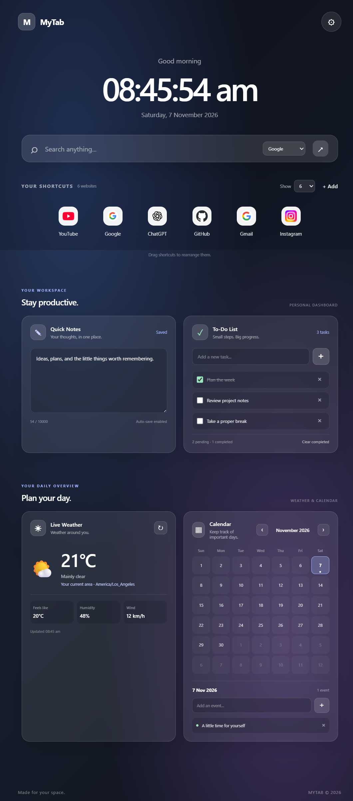
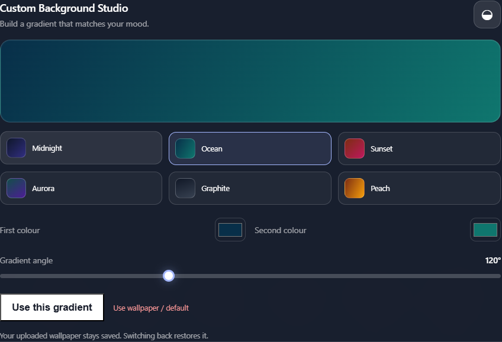

<div align="center">

# MyTab

### A calmer, more personal new tab.

Your shortcuts, notes, tasks, calendar, and local weather in one customizable dashboard.

[](https://github.com/immishra13/My-Tab/actions/workflows/validate.yml)


</div>

---

## Take a look

The full dashboard at a glance:

<p align="center">
  
</p>

<p align="center"><sub>Preview with example notes, tasks, and calendar events. Weather is illustrative.</sub></p>

Make the background your own:

<p align="center">
  
</p>

## What you get

| Your day | Your space |
| --- | --- |
| Live clock, date, and greeting | Wallpapers, gradient presets, and appearance controls |
| Search with Google, Bing, DuckDuckGo, or Yahoo | Rearrangeable dashboard and shortcuts |
| Quick notes and a to-do list | Custom themes, accent colours, and widget visibility |
| Monthly calendar and optional local weather | Preferences saved on your device |

## Get started

1. Download or clone this repository.
2. Open `chrome://extensions` in Chrome, or `edge://extensions` in Edge.
3. Turn on **Developer mode**.
4. Choose **Load unpacked** and select the project folder containing `manifest.json`.
5. Open a new tab. After changing files, reload MyTab from the extensions page.

## Privacy

- Preferences, shortcuts, notes, tasks, and calendar events are stored locally with Chrome Storage. Uploaded wallpapers stay in the extension's IndexedDB database.
- Weather is optional. When you request it, MyTab asks the browser for your location and sends the coordinates to Open-Meteo for a forecast. MyTab does not save your coordinates.
- Search terms go to the search provider you select. Website favicons are loaded from Google unless you set a custom icon URL.
- No analytics, ads, accounts, or backend service.

## Development

No package install or build step is needed. With Node.js installed, validate the manifest, referenced files, and JavaScript syntax:

```sh
node scripts/validate-project.mjs
```

GitHub Actions runs this check on every push and pull request.

```text
manifest.json   Chrome extension configuration
index.html      New-tab dashboard
css/            Dashboard and widget styles
js/             Dashboard features and browser storage
assets/         Project images and screenshots
scripts/        Local validation check
```
